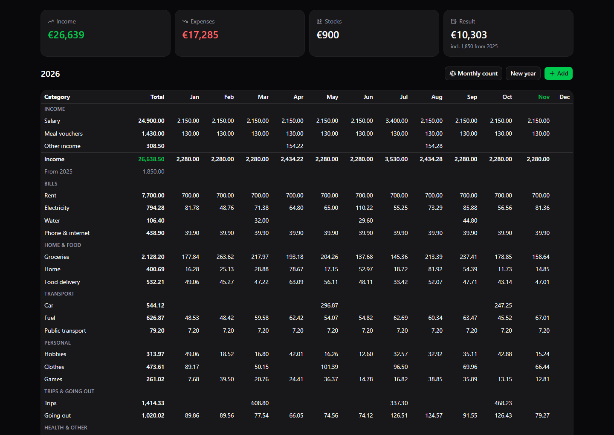
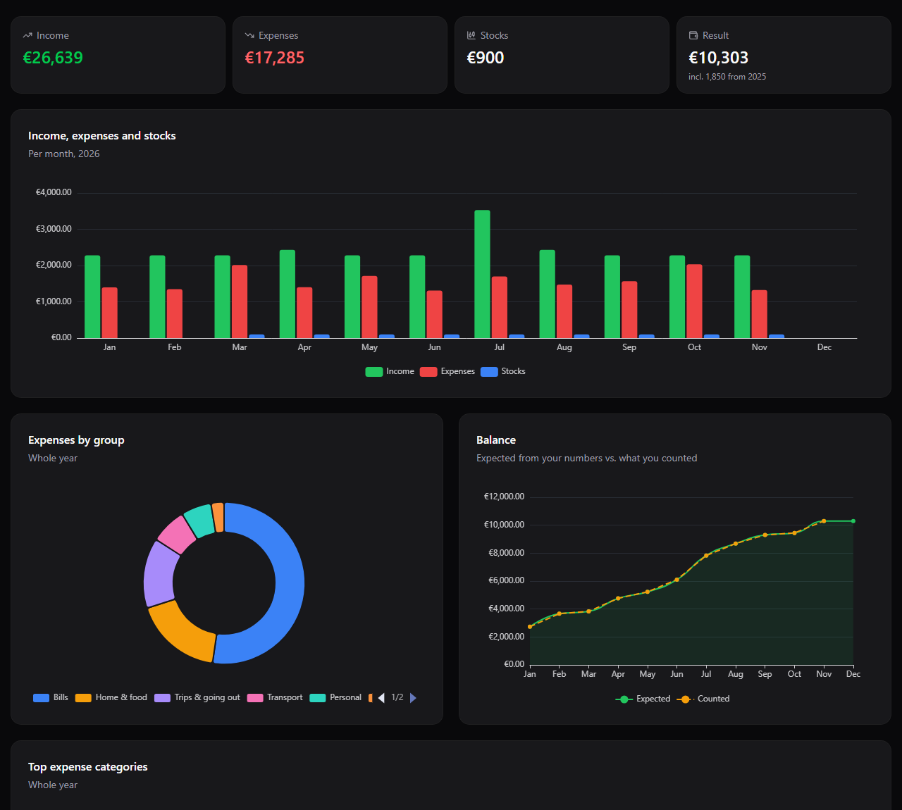
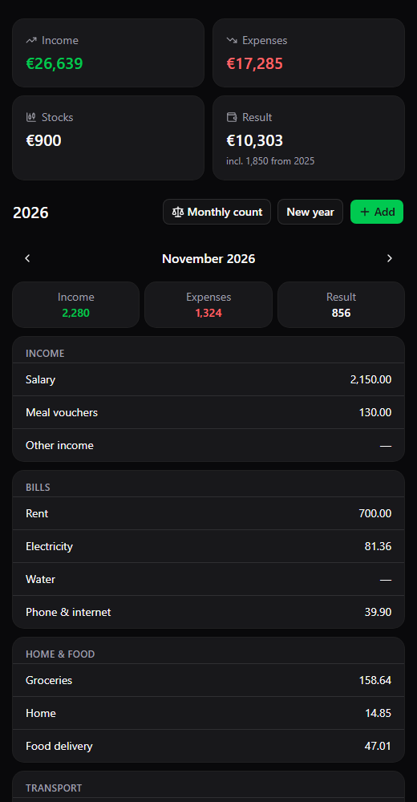

<div align="center">


# Personal Finances

**A yearly budget, the way you'd keep it in a spreadsheet — but as a fast, installable app. Free to run.**

Categories × months, monthly account counts, trips and purchases, standalone funds — with an optional live mirror to Google Sheets.

[Live app](https://personal-finances.net) · [Features](#features) · [Tech stack](#tech-stack) · [Run locally](#run-locally) · [Deploy your own](#deploy-your-own)

</div>

<p align="center">
  
</p>

<p align="center">
  
  &nbsp;
  
</p>

<p align="center"><sub>Screenshots use sample data.</sub></p>

## Features

- 🗓️ **Year view:** categories (in groups) × months with totals, before/after stocks and the yearly result — like a budget sheet. Tap any cell to see, add, edit or move its amounts. Future months are allowed. On phones it shows one month at a time.
- 🔁 **Years that carry over:** each year's result becomes the next year's opening balance. A new year starts clean with the categories you choose to keep.
- 🏷️ **Dynamic categories:** income, expense or stocks; grouped and reorderable. Categories with history are archived, never lost. Any category can hold named **items** (e.g. trips, big purchases).
- ✈️ **Trips:** every trip (or other item) across all years with its total and expenses; add expenses to an ongoing trip in one tap.
- ⚖️ **Monthly count:** enter what each account really holds; the app suggests the "untraced" correction for missing money.
- 🐷 **Funds:** standalone pots (a house budget, a gift card) that live outside your monthly cash flow.
- 📊 **Dashboard & entries:** charts (monthly totals, spending by group, expected vs counted balance, top categories) and a searchable, sortable list of every amount.
- 📄 **Google Sheets mirror (optional, per user):** after every change the app rewrites a sheet with one tab per year — same layout, real formulas (`=42.2+16.5`) — plus a Funds tab.
- 📥 **Spreadsheet import:** a script imports an existing yearly budget workbook and checks every month against the sheet's own totals.
- 📱 **Installable app (PWA):** one-tap install on Android, Chrome and Edge, with Add to Home Screen instructions on iOS. Installed apps show an update prompt after each deploy.
- 🔐 **Private by design:** Google sign-in. Every request is verified on the server, and each user only ever sees their own data.
- 💸 **€0 to run:** Cloudflare free plan plus Firebase Spark plan. No credit card needed.

## Tech stack

| Layer | Technology |
| --- | --- |
| Frontend | [Angular 22](https://angular.dev) (standalone components, signals), [Tailwind CSS v4](https://tailwindcss.com), [spartan/ui](https://spartan.ng) |
| Tables and charts | [TanStack Table v9](https://tanstack.com/table), [Apache ECharts](https://echarts.apache.org) via `ngx-echarts` |
| Backend | [Hono](https://hono.dev) on [Cloudflare Workers](https://workers.cloudflare.com) |
| Database and auth | [Cloud Firestore](https://firebase.google.com/docs/firestore) + [Firebase Authentication](https://firebase.google.com/docs/auth) (Google) |
| Sheet mirror | [Google Sheets API](https://developers.google.com/sheets/api) (service account, one shared sheet per user) |
| Hosting and CI | One Cloudflare Worker serves the app and the API, auto-deployed on every push to `main` |

## Architecture

```
                         ┌──────────────── Cloudflare Worker ────────────────┐
Browser / installed app ─┤  /*      Angular static assets (free, unmetered)  │
   (Firebase Auth:       │  /api/*  Hono API ── verify Firebase ID token ────┼──► Firestore (REST)
    Google sign-in)      └───────────────────── scoped to users/{uid} ───────┘
```

- **Same origin:** the frontend and API share one domain, so there's no CORS and no cold starts.
- **No direct database access from the browser:** [`firestore.rules`](firestore.rules) denies all client reads and writes. Only the Worker can reach Firestore, using a service account stored as an encrypted Cloudflare secret.
- **Cheap reads:** a whole year is one Firestore document plus one per month (~13 reads), so the free tier goes a long way.
- **Workers-native backend:** `firebase-admin` needs Node, so the API verifies tokens with [`jose`](https://github.com/panva/jose) and talks to Firestore over its REST API ([`backend/src/firestore.ts`](backend/src/firestore.ts)).

## Project structure

```
frontend/                 Angular app
  src/app/year/             year view, cell editor, monthly count, new year
  src/app/dashboard/        charts
  src/app/entries/          all amounts (TanStack Table)
  src/app/funds/            standalone funds
  src/app/categories/       categories, items, accounts, carry-over
  src/app/settings/         Google Sheet link
  src/app/core/             API client, store, calculations (ledger.ts), auth, PWA
  libs/ui/                  spartan/ui components (generated, editable)
backend/                  Hono API (Cloudflare Worker) + wrangler.jsonc
  src/routes/               years/categories/items/entries/counts, profile/accounts/funds/settings
  src/repo.ts               Firestore data access (optimistic concurrency)
  src/sheets.ts, sync.ts    Google Sheets mirror
  scripts/import-budget.ts  spreadsheet importer
scripts/                  local dev helper
firestore.rules        locks Firestore to the server only
```

## Run locally

**Prerequisites:** Node.js 24+, a Firebase project (see [Deploy your own](#deploy-your-own), step 1), and its service-account key saved as `backend/service-account.json`.

```bash
npm install
npm run dev
```

Open http://localhost:4200. `npm run dev` installs any missing dependencies, creates the local secrets file, and starts both servers:

- **API:** `wrangler dev` on port 8787.
- **App:** `ng serve` with live reload on port 4200. It proxies `/api` to the API.

| Command | Description |
| --- | --- |
| `npm run dev` | Run the app and API locally |
| `npm --prefix frontend test -- --watch=false` | Frontend unit tests |
| `npm --prefix backend run typecheck` | Type-check the Worker |
| `npm run deploy` | Build and deploy to Cloudflare manually |

## Deploy your own

Everything below fits in the free tiers.

### 1. Firebase

1. Create a project at [console.firebase.google.com](https://console.firebase.google.com). It stays on the free Spark plan.
2. **Firestore Database → Create database** in production mode. The location you pick is permanent.
3. **Authentication → Sign-in method → Google → Enable.**
4. **Project settings → Your apps → Web (`</>`)** → register an app. Copy `apiKey`, `authDomain`, `projectId` and `appId` into [`frontend/src/environments/`](frontend/src/environments/). These values are public by design.
5. **Project settings → Service accounts → Generate new private key** → save it as `backend/service-account.json`. It's git-ignored; never commit it.
6. Deploy the security rules:
   ```bash
   npm i -g firebase-tools
   firebase login
   firebase use --add                  # select your project
   firebase deploy --only firestore:rules
   ```

### 2. Configure

In [`backend/wrangler.jsonc`](backend/wrangler.jsonc):
- Set `FIREBASE_PROJECT_ID` to your project.
- Replace the `routes` domains with your own, or remove `routes` to use the free `*.workers.dev` URL.

Also update [`.firebaserc`](.firebaserc) with your project ID.

### 3. Cloudflare

```bash
cd backend
npx wrangler login
npm run secret:push        # uploads service-account.json as an encrypted secret
cd .. && npm run deploy
```

Then add your domain (or `*.workers.dev` hostname) under **Firebase → Authentication → Settings → Authorized domains**. Without it, Google sign-in fails on that domain.

**Optional, auto-deploy on push:** Cloudflare dashboard → *Workers & Pages → your Worker → Settings → Build → Connect* your repo:

| Setting | Value |
| --- | --- |
| Root directory | `backend` |
| Build command | `npm ci && npm --prefix ../frontend ci && npm --prefix ../frontend run build` |
| Deploy command | `npx wrangler deploy` |
| Build variable | `NODE_VERSION` = `24` |

## Optional: Google Sheets mirror

1. Enable the **Google Sheets API** for your Firebase project's Google Cloud project (APIs & Services → Library → Google Sheets API → Enable).
2. Create an empty sheet at [sheets.new](https://sheets.new) and **share it as Editor** with your service account's email (`client_email` in `service-account.json`; the app's Settings page also shows it).
3. Paste the sheet link into **Settings** in the app. The first sync runs immediately, then after every change.

The app owns that spreadsheet: it sets its locale to English (UK) so formulas like `=42.2+16.5` parse, and rewrites each year's tab. Tabs are protected with a warning to discourage manual edits.

## Import an existing budget workbook

`backend/scripts/import-budget.ts` imports a workbook with one tab per year and months as columns (income rows, an income total, the carry-over, expense rows in blank-line-separated groups, an expense total, stocks, the monthly account balances, and trip/purchase lists). Each month cell like `=42.2+53.88-16` becomes one entry per term.

```bash
cd backend
npm run import -- ../private/Budget.xlsx --dry-run      # parse + verify every month against the sheet totals
npm run import -- ../private/Budget.xlsx --sheet <id>   # write it (replaces the user's data) and mirror
```

Keep your workbook in `private/` (git-ignored). The labels it recognises are Greek (as in the original sheet); adapt the parser for other layouts.

## API

Every route except `/api/health` needs `Authorization: Bearer <Firebase ID token>` (the app sends it automatically). Mutations return the changed document.

| Area | Routes |
| --- | --- |
| Profile & settings | `GET /api/profile` · `GET /api/items` (items of all years) · `PUT /api/settings` `{ sheetId }` · `POST /api/sync` |
| Years | `GET /api/years/:y` · `POST /api/years` `{ year, opening, copyFrom?, categoryIds? }` · `PATCH /api/years/:y` `{ opening }` |
| Categories | `POST /api/years/:y/categories` · `PATCH …/categories/:id` · `POST …/categories/:id/move` · `DELETE …/categories/:id` (archives if used) |
| Items | `POST /api/years/:y/items` · `PATCH …/items/:id` · `DELETE …/items/:id` |
| Entries | `POST /api/years/:y/months/:m/entries` · `PATCH …/entries/:id` (incl. `month` to move) · `DELETE …/entries/:id` · `PUT /api/years/:y/months/:m/untraced` |
| Monthly count | `PUT /api/years/:y/counts/:m` `{ balances, stocksValue }` |
| Accounts | `POST /api/accounts` · `PATCH /api/accounts/:id` · `POST /api/accounts/:id/move` |
| Funds | `POST /api/funds` · `PATCH/DELETE /api/funds/:id` · `POST /api/funds/:id/entries` · `DELETE /api/funds/:id/entries/:eid` |

Data lives at `users/{uid}` (profile: accounts, funds, settings), `users/{uid}/years/{year}` (categories, items, counts, opening) and `users/{uid}/years/{year}/months/{m}` (entries).

## Free-tier limits

| Service | Limit | Typical personal use |
| --- | --- | --- |
| Cloudflare Workers | 100k API requests/day, 10 ms CPU/request | well under 1% |
| Firestore | 50k reads, 20k writes/day, 1 GiB storage | well under 1% |
| Firebase Auth | 50k monthly active users | 1 |
